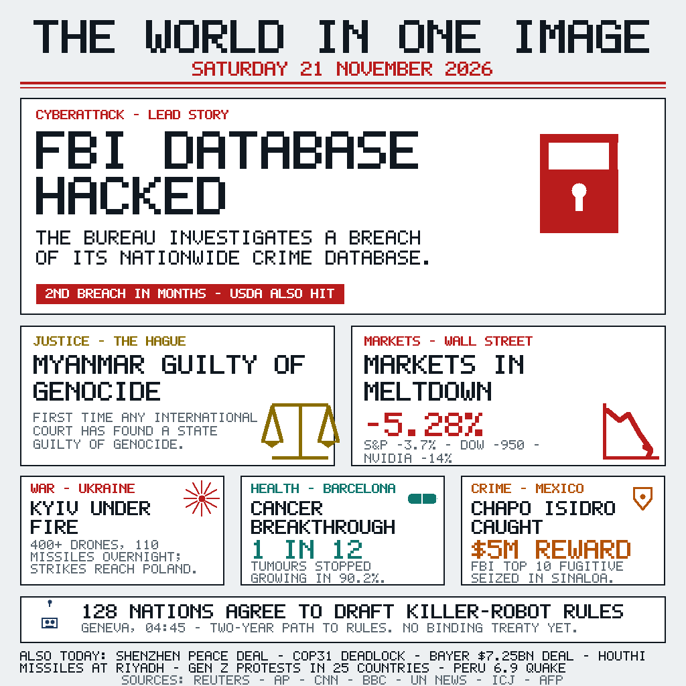

# news-image-20261121 v4 — "THE FRONT PAGE"

[](https://make.fun/bounty/news-image-20261121?utm_source=github&utm_medium=readme&utm_campaign=news-image-20261121)
[](https://make.fun/bounty/news-image-20261121/leaderboard?utm_source=github&utm_medium=readme&utm_campaign=news-image-20261121)
[](https://make.fun/bounty/news-image-20261121?utm_source=github&utm_medium=readme&utm_campaign=news-image-20261121)

SPDX-License-Identifier: MIT

One image that sums up Saturday 21 November 2026's world news, for the
make.fun competition `news-image-20261121`.



Alt text: A broadsheet front page titled "THE WORLD IN ONE IMAGE",
dated Saturday 21 November 2026. Lead story: FBI database hacked.
Also: Myanmar guilty of genocide, markets in meltdown (Nasdaq -5.28%),
Kyiv under fire, a cancer breakthrough, El Chapo Isidro caught, and
128 nations agreeing to draft killer-robot rules.

## The day, in seven stories

1. **FBI DATABASE HACKED** (lead) — the FBI investigates a breach of its
   nationwide crime database, the second intrusion of an FBI system in
   months; the US Agriculture Department was hit too.
2. **MYANMAR GUILTY OF GENOCIDE** — the ICJ finds Myanmar committed
   genocide against the Rohingya, the first time any international court
   has found a state guilty of genocide.
3. **MARKETS IN MELTDOWN** — Nasdaq -5.28%, S&P -3.7%, Dow -950,
   Nvidia -14%.
4. **KYIV UNDER FIRE** — 400+ drones and 110 missiles overnight; strikes
   reach Poland.
5. **CANCER BREAKTHROUGH** — daraxonrasib + chemo: tumours undetectable
   in 1 in 12 patients, stopped growing in 90.2%.
6. **CHAPO ISIDRO CAUGHT** — FBI Top 10 fugitive seized in Sinaloa;
   $5m reward.
7. **128 NATIONS AGREE TO DRAFT KILLER-ROBOT RULES** — Geneva, 04:45:
   a two-year path to rules on autonomous weapons; no binding treaty yet.

Also today: Shenzhen peace deal, COP31 deadlock, Bayer $7.25bn deal,
Houthi missiles at Riyadh, Gen Z protests in 25 countries, Peru 6.9 quake.

Sources: Reuters, AP, CNN, BBC, UN News, ICJ, AFP.

## How it is made

`main.py` is pure Python standard library. It draws the front page with a
hand-written 5x7 bitmap font, a small shape rasterizer (padlock, scales,
chart, burst, capsule, badge, robot pictograms) and a hand-written PNG
encoder (zlib). No Pillow, no numpy, no network, no third-party packages.

```sh
python3 main.py            # writes entry.png to $MAKEFUN_OUTPUT_DIR (/output)
python3 -m unittest test_main -v
```

Output is deterministic: identical bytes on every run (1024x1024,
20,737 bytes, under the 1 MiB limit).

## Version history

- v4 (this repo) — "THE FRONT PAGE": single-lead pyramid front page,
  7 main stories. Built from scratch in its own session.
- v3 — "WORLD ON ALERT": twin leads + 2x2 grid, 6 main stories,
  dev-judge win rate 95.6% (10W/2D/0L), scored round 3.
